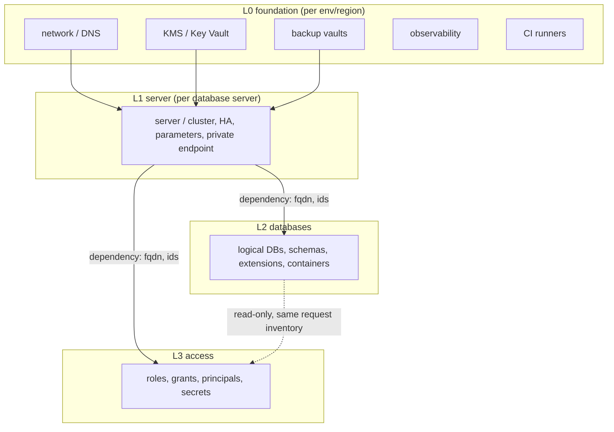
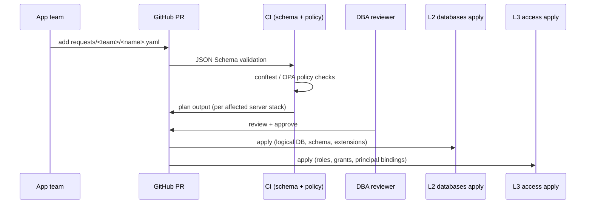

# Architecture

## Layering (ADR 0001)

Each box above is a separate Terragrunt stack with its own state and
its own pipeline identity. See ADR 0001 for why, and section 7 of the
platform spec for the full dependency/state-backend rules.

## Request flow

## Why "one stack per server"

Terraform provider blocks cannot be `for_each`'d. The `postgresql`,
`mssql`, and `mysql` providers each authenticate to one server. Since
L2/L3 need those providers, the server is necessarily the
state/provider boundary — see ADR 0001.

## Why many databases can share a server, and when they can't

See ADR 0004. Short version: shared servers share a CMK, maintenance
window, major version, and backup/PITR window; `restricted` data never
shares, and every shared server has an enforced database-count and
connection-budget cap.

## Naming convention

| Thing | Pattern | Example |
|---|---|---|
| AWS server identifier | `<org>-<env>-<engine>-<purpose>` | `acme-prod-pg-shared01` |
| Azure server name | `<engine-abbrev>-<org>-<env>-<region-abbrev>-<purpose>` | `psql-acme-prod-sea-shared01` |
| Logical database | `^[a-z][a-z0-9_]{2,30}$` | `payment` |
| Postgres group role | `<db>_<tier>` | `payment_owner`, `payment_rw` |
| AWS login principal | `<kind>_<db>_<svc>` | `app_payment_api` |
| Azure login principal | Entra object name, bound by object id | `mi-payment-api` |
| Entra group | `grp-<team>-db-eng-<ro\|rw>` | `grp-payment-db-eng-rw` |
| Tags (all resources) | `managed-by, repo, org, env, cloud` minimum | — |

`# TODO(verify)`: finalize the exact AWS/Azure resource-name length
limits per engine (e.g. RDS identifiers cap at 63 chars, Azure
PostgreSQL Flexible server names have their own limit) before this
convention is enforced as a `tflint`/policy rule.
